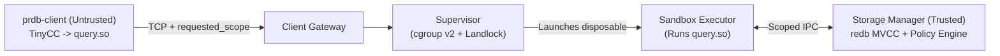

# PRDB Technical Documentation

PRDB is an operational database with analytical query support, built in Rust with a TinyCC-compiled C SDK for client queries. It is designed around **strict trust boundaries**, **OS-level process isolation** (without a VM), **MVCC snapshot isolation**, and **true cell-specific authorization policies**.

## Architecture & Trust Boundaries

PRDB separates untrusted query compilation and execution from trusted storage, catalog, and policy enforcement:

### Core Components

- **Client (`prdb-client`)**: Compiles SQL/C queries locally using TinyCC against a versioned SQL/runtime SDK (`libprdb_sql.so.1`) into a native `query.so` library, and submits it with a `requested_scope` (`.psc1`).
- **Client Gateway**: Dedicated TCP listener that handles transport-independent admission, authentication, and bounded result relay.
- **Supervisor**: Manages disposable executor process lifecycles, execution identity, and OS resource budgets using Linux **cgroups v2** (`cpu`, `memory`, `pids`) and **Landlock** filesystem policies.
- **Sandbox Executor**: An untrusted, disposable native host that loads `query.so` for a single invocation. It never accesses raw storage files and only sees authorized, redacted data over scoped IPC.
- **Storage Manager**: The trusted data-access layer backed by **redb** MVCC. It pins the catalog/policy snapshot at transaction start and enforces **row**, **column**, and **cell** policies before any data reaches the executor.
- **Optimizer**: Isolated planning service that produces structured physical plans using only authorized planning statistics.

## Documentation Index

- **[Security & Authorization Model](security.md)** — Default-deny enforcement, scope intersection, row/column/cell policies, `REDACTED` semantics, and Linux sandboxing.
- **[Client & SDK Guide](client.md)** — Using `prdb-client`, TinyCC compilation profiles, `admin-sql`, and `interactive-sql` sessions.
- **[Interactive Docker Compose Demo](docker-demo.md)** — Step-by-step hands-on demo using `docker/compose.yaml` to test column, row, and cell policies live.
