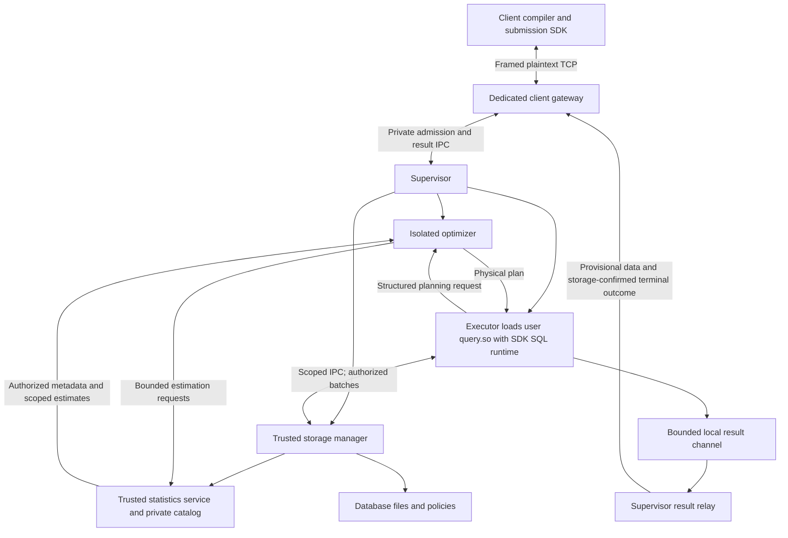

# Architecture

## Goals and Status

Design a local database engine that executes user query libraries compiled in the client using an SDK, with Linux OS processes for isolation and no VM. The established toolchain is TinyCC for C user queries and SDK SQL/runtime code, and Rust for database-engine processes; see the [toolchain decision](toolchain.md). Permissions must support different access to the same column across visible rows. This is a research design, not an implementation or security guarantee.

## Workload and Storage Direction

This is primarily an operational database: optimize for short transactions, point/range access, concurrent small writes, and predictable durable commit latency. Analytical queries are supported over the same authorized MVCC data, with scan-resistant caching and bounded analytical CPU/I/O/history budgets. See [workload profile](workload-profile.md) for the explicit SQL analytics roadmap; the first parser slice remains intentionally small.

Use the [row-oriented 16 KiB page format](storage-format.md), B-tree indexes, and [Rust buffer/private-transaction model](memory-storage.md). [WAL v1](wal-recovery.md) logs full-page after-images before publication; its initial write amplification is a measured optimization target. [io_uring](disk-io.md) is the preferred storage I/O backend with a declared blocking fallback and identical durability semantics. Borrow buffers internally; copy only authorized values into executor output. No raw storage-page sharing is permitted.

## Security Invariant

An executor can obtain only data authorized for its invocation context, regardless of the instructions it executes or the protocol messages it sends. Once a value is delivered, assume the worker can disclose it through permitted output.

The host kernel, client gateway, supervisor, storage manager, trusted policy evaluator, and storage-owned statistics service form the security boundary. The gateway handles plaintext credentials/results but has no database-file or executor-launch authority. Treat the executor, submitted query library, and bundled SDK as compromised from launch. Treat optimizer output as untrusted for authorization purposes. An optimizer may still affect result correctness and disclose any statistics it receives.

## Components

The [client gateway](client-gateway.md) is a dedicated Rust process and owns the client listener. The initial [client protocol](client-protocol.md) is framed unencrypted TCP, bound to loopback by default; secure/alternative transports are future gateway adapters. Executors never connect directly to network clients. No additional intermediary process beyond this gateway is required.

The supervisor and storage manager may initially share a process; neither owns the public TCP listener. The optimizer runs separately from both storage and the executor. A thread provides concurrency but no memory isolation. Native query libraries must never be loaded into the storage manager.

The executor (query worker) is a generic native host. The client compiles user code into a loadable query library using the [client SDK](client-sdk.md). The SDK includes the reusable [SQL library](sql-library.md), component protocol definitions, and client stubs. Proposed packaging links a prebuilt SQL/runtime archive into query.so; the executor loads the user artifact, not a separate server-selected SQL entry point. The optimizer returns physical plans and does not compile the user program.

## Execution Flow

1. The client compiles and links query.so, authenticates through the gateway, and uploads bounded artifact/manifest/parameter bytes into a supervisor-owned reservation. The client receives an invocation ID before explicitly starting execution. Uploading pins no MVCC snapshot. At START the supervisor revalidates identity with storage and computes a proposed invocation-specific grant narrower than or equal to that identity's authority.
2. The storage manager creates a server-side context binding identity, scope, MVCC data/schema snapshot, private write set, policy version and inputs, and budgets.
3. The supervisor provisions separate planner-to-storage estimation and executor-to-planner submission channels bound to the same execution authority. It launches a confined executor with scoped storage access, approved library/artifact resources, and bounded output.
4. The executor loads the submitted query library after confinement and invokes its versioned entry point with host services and parameters. User code can call SDK SQL functions or scoped lower-level storage APIs. SQL calls parse and submit structured requests to the separate optimizer, which validates them and returns physical plans using scoped estimates or fixed heuristics.
5. The SQL library initially interprets the plan and requests batches through host services; user code may also issue direct storage requests. Sequential statements share the invocation transaction and cumulative budgets, observe successful prior writes, and permit one active statement/request stream at a time. Storage independently validates every request and applies row and cell policies before transmission. Compilation of user code has already happened in the client; server-side native plan generation is outside the baseline.
6. Successful library return triggers storage commit; only a durable commit decision permits success. Errors, cancellation, or timeout accepted before irreversible COMMIT submission abort all private writes; later races require resolving the durable outcome. After the terminal transaction outcome, close channels and release resources once in-flight tasks drain. Statement success alone does not commit. Output is relayed through the supervisor and gateway as provisional network data frames. Only a storage-confirmed terminal outcome establishes commit; this does not prove that untrusted code computed honestly. Disconnect/gateway failure follows the same cancellation barrier and authenticated status-reconciliation rules.

Direct storage calls can bypass SQL planning but must use the same scoped protocol and sandbox. Standalone executable support is a possible later adapter; the primary submission format is a client-built shared library.

## Concurrency and Transactions

Use [MVCC with snapshot isolation](concurrency-mvcc.md) from the first implementation, supporting concurrent readers and writers. Each invocation owns one transaction: a fixed committed snapshot plus its private writes, shared by SQL and direct SDK calls. Storage performs optimistic row-level conflict checks and serializes final commit validation/publication. This does not provide serializable isolation or general cross-row invariant enforcement.

On successful user-library return, the supervisor requests commit through a privileged control channel. Storage durably commits all writes or aborts the entire transaction. Any statement error aborts the transaction initially; savepoints are deferred. Success is reported only after commit, and lost replies are reconciled through authenticated transaction status. See the concurrency spec for policy revalidation, cancellation races, logging, bounded scheduling, and version reclamation.

## Schema, Users, and Permission Administration

The client submission SDK provides a separate authenticated control-mode gateway connection for [schema DDL](ddl-schema.md), [users/roles](ddl-identity.md), and [permission DDL](ddl-permissions.md). Storage independently validates definitions and current administrative authority. Executors cannot issue DDL or carry admission credentials. Database users authenticate initially with revocable database tokens; roles supply inherited grants and policy applicability.

Tables have mandatory default-deny row and cell policies in addition to object/column grants. Owners administer definitions but have no automatic data bypass. Initial schema support includes tables, scalar types, primary/unique/foreign-key/check constraints, B-tree indexes, and bounded alterations. Global constraint outcomes can reveal hidden key existence; this is an explicit limitation alongside timing inference.

Catalog changes participate in MVCC/durable ordering. DDL fences affected write commits while preserving pinned reader schemas; long builds do not hold the global commit gate. Identity, grant, and policy changes affect admission and write-commit epoch checks. See the DDL specs for scope and examples.

## Data Dictionary and Metadata

The storage-owned [data dictionary](data-dictionary.md) defines versioned logical objects, identities, grants, policies, dependencies, and cache validity. [Metadata discovery](metadata-discovery.md) exposes bounded authorized projections through IPC and built-in `information_schema` relations; raw catalogs are never executor tables.

[Catalog lifecycle](catalog-lifecycle.md) specifies bootstrap without SQL, validated startup, independent format versions, and offline upgrades. [Physical metadata](physical-metadata.md) owns roots, allocation, logging/checkpoints, reclamation, and durable outcomes. [Operational metadata](operational-metadata.md) exposes authenticated live status outside invocation MVCC snapshots. These classes intentionally have distinct consistency and disclosure rules.

## Statistics Boundary

Collection and optimization are separate responsibilities. Trusted storage routines may collect private global statistics, but the isolated optimizer receives only summaries derived from its execution's authorized view or public configuration. A numeric cost or selectivity can reveal private data just as a histogram can. Do not grant global statistics access merely because planning runs in another process.

The [statistics service](statistics-service.md) starts as a module within storage. Scoped on-demand estimates have independent work budgets. Global maintenance, cache reuse, and sampling are later optimizations with explicit validity and disclosure rules. A privileged optimizer is an alternative trust model, not the baseline.

## Guarantees and Limits

- Authorization applies to the principal-specific view, including storage-side operations.
- Confinement does not establish correct query results: malicious workers can fabricate or omit results.
- The kernel remains trusted; kernel exploits and comprehensive timing/cache side-channel prevention are outside the initial prototype's guarantees.
- Hidden-data inference through authorized outputs, errors, statistics, and execution time remains a research concern. Explicit redaction reveals that a field is unavailable.
- Revocation cannot erase values already delivered.

## Initial Milestone

Build a concurrent read/write prototype with MVCC, durable atomic commit, DDL-created tables/indexes, two database users with role membership, row-dependent field permissions, a client-built query library linked with SDK SQL support and a physical-plan interpreter, copied IPC batches, and a disposable executor per invocation. Add bounded authorized-view estimates with heuristic fallback; global statistics collection is not required initially. Demonstrate a malicious query library using the same storage protocol.

Validate isolation and authorization for client-built libraries before expanding compilation backends. Measure batch-transfer and policy-evaluation overhead before introducing shared memory. Exercise concurrent updates, conflicts, rollback, policy changes, recovery, and reclamation from the first milestone. SQL joins/grouping/aggregation/sorting are the required analytical follow-on in the workload profile, with mixed-workload validation. Serializable isolation, broad Linux executable compatibility, and privileged aggregates over hidden values remain separate future work.

## Open Decisions

- Credential protocol/cryptography details and the representation of invocation-specific grants.
- Supported Linux kernel features and deployment privilege requirements.
- Result-correctness guarantees for optimizer plans, SDK execution, and arbitrary user query libraries.
- Policy expression implementation, dependency validation, and immediate read revocation.
- Format payload fixtures, synchronization primitives, io_uring platform profile, and exact analytical SQL semantics.
